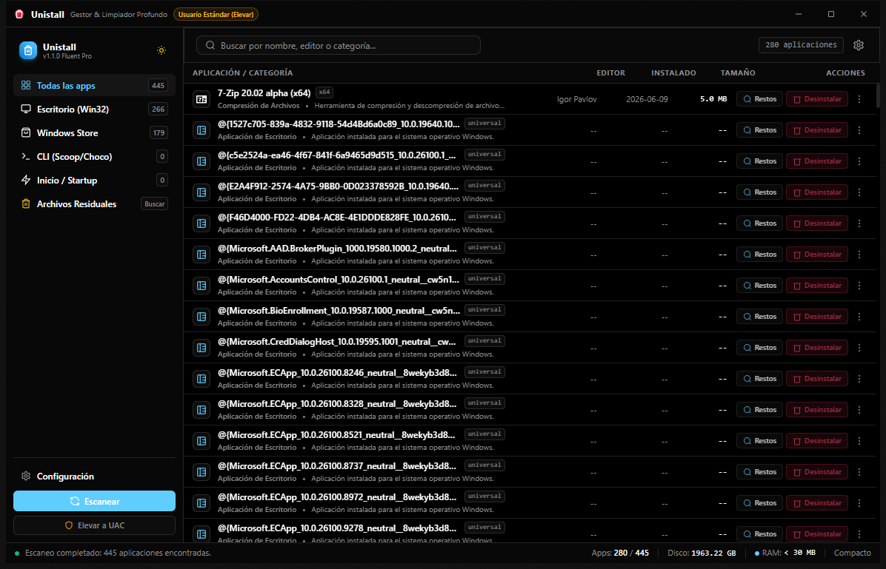

<div align="center">

  

  # Unistall

  ### Desinstalador y Gestor de Software Profesional para Windows

  **Ultrarrápido • Huella de memoria mínima • Limpieza profunda heurística • Windows 11 Fluent Design**

  <p align="center">
    <a href="https://github.com/Dreftian/Unistall/releases/latest"></a>
    <a href="https://github.com/Dreftian/Unistall/releases"></a>
    <a href="https://github.com/Dreftian/Unistall/blob/main/LICENSE"></a>
    
  </p>

  <p align="center">
    
    
    
    
    
  </p>

  <p align="center">
    <a href="#-descarga-e-instalación"><strong>Descargar v1.0.0</strong></a> •
    <a href="#-características-principales">Características</a> •
    <a href="#-especificaciones-y-rendimiento">Benchmarks</a> •
    <a href="#-arquitectura-técnica">Arquitectura</a> •
    <a href="#-compilación-desde-código-fuente">Compilar</a>
  </p>

</div>

---

## 📸 Captura de Pantalla

<div align="center">
  
  <p><em>Panel principal de Unistall en Windows 11: listado instantáneo de 400+ aplicaciones, clasificación multi-fuente y telemetría de recursos en tiempo real.</em></p>
</div>

---

## 💡 ¿Por qué Unistall?

La mayoría de desinstaladores comerciales de terceros están sobrecargados de publicidad, telemetría invasiva, interfaces obsoletas y consumos desmedidos de memoria RAM (a menudo superando los 300-500 MB). Por otro lado, la herramienta nativa de Windows suele dejar cientos de megabytes en archivos residuales (`AppData`, `ProgramData`) y claves huérfanas en el Registro de Windows.

**Unistall** nace para resolver esto de manera definitiva:
- 🚀 **Cero bloatware**: Sin rastreadores, sin publicidad y de código abierto bajo licencia MIT.
- ⚡ **Rendimiento nativo**: Escrito en **Rust 2021** conectando directamente con las APIs de Win32 y NT.
- 🧼 **Limpiador Heurístico Profundo**: Rastrea restos de programas desinstalados con cálculo de confianza (*Confidence Score*) para proteger el sistema operativo.
- 🎨 **Experiencia Fluent de Windows 11**: Efecto Mica/Acrylic, modo oscuro/claro y desplazamiento virtual fluido a 120 FPS.

---

## ⚡ Especificaciones y Rendimiento

| Métrica | Unistall | Desinstaladores Tradicionales |
| :--- | :---: | :---: |
| **Arranque en frío (Cold Start)** | **< 150 ms** | 1.8 s - 4.5 s |
| **Consumo de Memoria RAM** | **< 30 MB** | 180 MB - 550 MB |
| **Tamaño del Instalador** | **1.5 MB** | 25 MB - 80 MB |
| **Binario Portable** | **4.8 MB** | 40 MB - 120 MB |
| **Tasa de Refresco de Lista** | **120 FPS (Virtual Scrolling)** | Con caídas a < 30 FPS |
| **Capacidad de Elementos** | **10,000+ aplicaciones sin lag** | Congelamientos frecuentes |
| **Tiempo de Escaneo Inicial** | **< 1 segundo (multihilo con Rayon)** | 5 s - 15 s |

---

## ✨ Características Principales

### 🔍 1. Escáner Multi-Motor Instantáneo
Rastreo exhaustivo en paralelo a través de todos los orígenes de software en Windows:
- **Win32 Nativo 64-bit**: `HKLM\Software\Microsoft\Windows\CurrentVersion\Uninstall` (acceso directo `KEY_WOW64_64KEY`).
- **Win32 WoW6432Node 32-bit**: `HKLM\Software\WOW6432Node\Microsoft\Windows\CurrentVersion\Uninstall` (`KEY_WOW64_32KEY`).
- **Instalaciones de Usuario**: `HKCU\Software\Microsoft\Windows\CurrentVersion\Uninstall`.
- **UWP / Windows Store / MSIX**: Detección nativa mediante el repositorio Win32 AppModel (sin subprocesos lentos de PowerShell).
- **Gestores de Paquetes CLI**: Soporte nativo para aplicaciones instaladas mediante **Scoop**, **Chocolatey** y **Winget**.
- **Extracción de Metadatos**: Iconos nativos (`DisplayIcon`), cálculo asíncrono de tamaño real en disco, fechas de instalación y comandos silenciosos (`QuietUninstallString`).

### 🧹 2. Cazador Heurístico de Restos (Deep Cleaner)
Cuando un programa se desinstala, casi siempre deja huellas que saturan el disco:
- **Rastreo profundo en el Sistema de Archivos**: `%AppData%`, `%LocalAppData%`, `%ProgramData%` y `%Temp%`.
- **Rastreo profundo en el Registro**: Claves huérfanas en `HKCU\Software` y `HKLM\Software`.
- **Algoritmo de Certeza (Confidence Score 0-100%)**: Clasifica cada elemento para prevenir falsos positivos y evitar tocar archivos críticos del sistema.
- **Tecnología Windows Restart Manager**: Si un archivo residual está bloqueado por otro proceso, Unistall utiliza la API de Restart Manager para desbloquearlo o programar su eliminación segura en el siguiente reinicio mediante `MoveFileExW` (`MOVEFILE_DELAY_UNTIL_REBOOT`).

### 🚀 3. Gestor de Inicio de Windows (Startup Manager)
- Inspecciona las aplicaciones configuradas para iniciar con Windows en `HKCU\Run` y `HKLM\Run`.
- Habilita o deshabilita programas de inicio en 1 clic para acelerar los tiempos de arranque del equipo.

### 🪄 4. Asistente de Desinstalación Inteligente (Wizard)
- Ejecuta el desinstalador nativo del software con opción silenciosa.
- Supervisa la finalización del proceso e inicia automáticamente el escaneo de restos residuales.
- Vista previa clara de todos los archivos y entradas de registro encontrados antes de confirmar la eliminación.

### 🛡️ 5. Modo No Invasivo & Elevación UAC Dinámica
- Funciona como usuario estándar para la inspección y solo solicita privilegios administrativos mediante elevación de UAC cuando se requiere modificar archivos protegidos o claves del registro a nivel de máquina (`HKLM`).

---

## 📦 Descarga e Instalación

Puedes descargar los archivos compilados oficiales desde la sección de **[Releases](https://github.com/Dreftian/Unistall/releases/latest)**:

| Tipo | Archivo | Tamaño | Descripción |
| :--- | :--- | :---: | :--- |
| **Instalador Oficial** | [`Unistall_Setup_v1.0.0.exe`](https://github.com/Dreftian/Unistall/releases/download/v1.0.0/Unistall_Setup_v1.0.0.exe) | `1.5 MB` | Asistente de instalación NSIS Modern UI 2 con accesos directos y modo silencioso. |
| **Versión Portable** | [`unistall.exe`](https://github.com/Dreftian/Unistall/releases/download/v1.0.0/unistall.exe) | `4.8 MB` | Binario autónomo sin dependencias externas. No requiere instalación. |

### Instalación Silenciosa (Para Administradores de Sistemas):
```cmd
Unistall_Setup_v1.0.0.exe /S
```

### Verificación de Integridad (SHA-256):
```powershell
# Verificar instalador
Get-FileHash -Algorithm SHA256 "Unistall_Setup_v1.0.0.exe"
# 1C86C88FBBDE6BF8F7B72BDC1A6519DB9DB61F1A45037E6944B26237E72B45E2

# Verificar portable
Get-FileHash -Algorithm SHA256 "unistall.exe"
# 9477009A858FF16572219B0397F3EF14E1684D78B6BAF1FB5EB0291E661C1BBC
```

---

## 🏗️ Arquitectura Técnica

```
Unistall/
├── src/                          # Frontend en Svelte 5 + TypeScript
│   ├── components/               # Componentes modulares UI Fluent
│   │   ├── TitleBar.svelte       # Barra de título personalizada Mica
│   │   ├── Sidebar.svelte        # Navegación lateral con contadores
│   │   ├── VirtualList.svelte    # Renderizador de lista virtual 120 FPS
│   │   ├── AppRow.svelte         # Tarjeta de aplicación con acciones rápidas
│   │   ├── ResidualsView.svelte  # Explorador de archivos residuales
│   │   ├── UninstallWizardModal  # Flujo guiado de desinstalación + limpieza
│   │   └── SettingsModal.svelte  # Configuración y temas
│   ├── stores/appStore.ts        # Gestión reactiva de estado (Svelte stores)
│   └── lib/tauriBridge.ts        # Enlace asíncrono con el motor de Rust
├── src-tauri/                    # Backend nativo en Rust
│   ├── src/
│   │   ├── scanner/              # Escaneo del Registro, AppModel, Scoop/Choco
│   │   ├── deep_cleaner/         # Motor heurístico de búsqueda de restos
│   │   ├── startup/              # Gestión de entradas de inicio
│   │   └── main.rs               # Núcleo y canales de streaming IPC
│   ├── tauri.conf.json           # Configuración de Tauri v2
│   └── Cargo.toml                # Dependencias nativas (windows-rs, rayon, etc.)
└── Install/                      # Script NSIS Modern UI 2
    ├── Unistall_Installer.nsi    # Script del instalador
    └── build_installer.bat       # Automatización de empaquetado
```

---

## 🛠️ Compilación desde Código Fuente

Si deseas compilar Unistall por tu cuenta:

### Requisitos previos
- [Node.js](https://nodejs.org/) (versión 20 o superior)
- [Rust & Cargo](https://rustup.rs/) (versión 1.80 o superior con target `x86_64-pc-windows-msvc`)
- [NSIS 3.x](https://nsis.sourceforge.io/) *(Opcional, solo para generar el instalador `.exe`)*

### 1. Clonar el repositorio
```bash
git clone https://github.com/Dreftian/Unistall.git
cd Unistall
```

### 2. Instalar dependencias del frontend
```bash
npm install
```

### 3. Ejecutar en modo desarrollo con recarga en vivo
```bash
npm run tauri dev
```

### 4. Compilar binario de producción
```bash
# Compilar frontend
npm run build

# Compilar backend nativo de Rust
cd src-tauri
cargo build --release
```
El binario portable optimizado se generará en `src-tauri/target/release/unistall.exe`.

### 5. Generar el Instalador Oficial (NSIS)
```cmd
cd Install
build_installer.bat
```
El archivo de instalación resultante se creará en `Install/Unistall_Setup_v1.0.0.exe`.

---

## 🤝 Contribuciones

Las contribuciones, sugerencias y reportes de errores son más que bienvenidos. Si deseas colaborar:
1. Haz un Fork del proyecto.
2. Crea una rama para tu característica (`git checkout -b feature/nueva-mejora`).
3. Confirma tus cambios (`git commit -m "feat: agrega nueva mejora"`).
4. Haz push a tu rama (`git push origin feature/nueva-mejora`).
5. Abre un **Pull Request**.

---

## 📄 Licencia

Este proyecto está distribuido bajo la licencia **MIT**. Consulta el archivo [LICENSE](LICENSE) para más detalles.

---

<div align="center">
  <sub>Desarrollado con ❤️ y dedicación por <a href="https://github.com/Dreftian"><strong>Dreftian</strong></a></sub>
</div>
